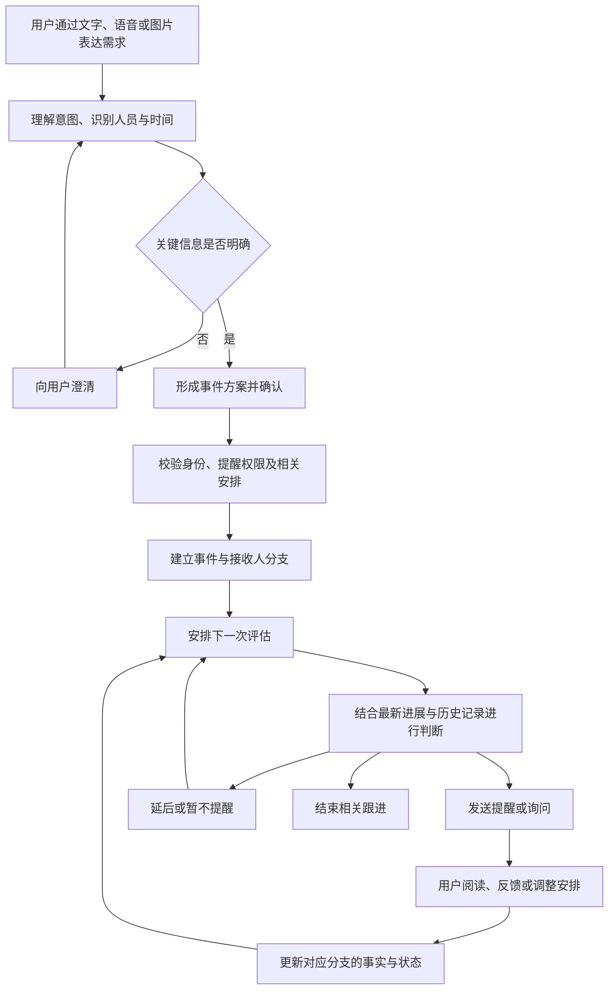

# AI小醒系统说明

> 本文依据截至 2026 年 10 月 15 日的系统实现整理，面向业务介绍、产品沟通及使用说明。具体功能是否可用，以部署配置、已安装的 APP 版本及相应平台支持情况为准。

## 一、目的：主要解决什么问题

### 1.1 系统定位

AI小醒是一套通过自然语言创建提醒、根据事情进展动态安排后续跟进、支持好友之间协同提醒的智能提醒系统。

用户可以直接说出“什么事情、提醒谁、什么时候需要完成”，系统负责理解需求、确认必要信息、建立事件，并结合后续反馈持续跟进。它既服务于个人待办，也服务于需要他人参与的工作和生活事项。

系统由用户 APP、管理后台和统一下载页组成。用户通过 APP 创建及处理事件，管理人员通过后台维护模型、查看运行情况并管理应用分发。

### 1.2 需要解决的问题

| 常见问题 | 系统的解决方式 |
| --- | --- |
| 事情分散在聊天、口头沟通和个人记忆中，容易遗漏 | 通过对话将需求整理为可持续跟进的事件，集中查看 |
| 设置提醒需要手动填写多个字段，操作繁琐 | 支持文字、语音及图片输入，由 AI 提取任务、人员和时间等信息 |
| 固定时间的提醒无法适应计划变化 | 用户补充进度或调整安排后，系统重新判断后续跟进时机 |
| 事情交给别人后，需要反复询问进度 | 支持向好友发起事件，按接收人的反馈分别跟进 |
| 多人参与同一事项时，任务和进度容易混淆 | 为每位接收人维护独立任务、进展和提醒状态 |
| 消息已读后，无法判断事情是否真正完成 | 区分已读、进度反馈和结束跟进，保留事件处理记录 |
| 换设备、换平台时，应用下载入口分散 | 提供统一下载页和二维码，后台集中配置各平台下载渠道 |

### 1.3 适用场景

- **个人安排**：会议、出行、提交材料、生活事项及日常待办。
- **工作协同**：提醒同事提交报告、发送合同、完成设计或推进项目事项。
- **多人跟进**：同一事件分配给多个接收人，各自负责不同内容并分别反馈。
- **持续性事项**：暂时没有明确截止日期，但需要根据进展定期重新判断是否跟进的事情。

系统希望减少用户记忆、设置和追问的负担，让事情有记录、进展可追踪、提醒能随实际情况调整。

## 二、业务逻辑

### 2.1 角色与核心概念

| 角色或概念 | 业务含义 |
| --- | --- |
| 发起人 | 创建事件的人，负责说明目标，可调整事件、查看相关进展或停止整个事件 |
| 接收人 | 被提醒及执行任务的人，可查看自己的任务、反馈进展并结束自己的跟进 |
| AI 助手 | 理解用户输入，整理事件方案，并结合上下文和进度辅助判断后续动作 |
| 管理员 | 维护系统模型、查看事件和提醒运行记录、管理 APP 版本及下载渠道 |
| 事件 | 一件需要处理或持续跟进的事情，包含发起人、内容、时间要求和接收人等信息 |
| 接收人分支 | 一个事件中某位接收人的独立任务记录，包含其任务内容、最新进展、状态及下次评估时间 |
| 评估 | 到达计划时点后，系统重新判断当前是否需要提醒、询问、延后或结束跟进 |
| 提醒通知 | 实际发送给用户的提醒或询问消息 |
| 事件时间线 | 记录事件创建、修改、反馈、评估、通知、已读和停止等过程 |

### 2.2 整体业务流程

这是一套持续跟进的循环。系统会随着新信息更新下一步安排，而不是在创建时一次性固定所有未来通知。

### 2.3 通过对话创建和调整事件

1. **表达需求**：用户输入“明天下午提醒小王提交报告”等自然语言，也可以通过语音或图片补充内容。
2. **理解意图**：系统区分普通聊天、创建事件、修改方案、反馈进度、调整已有事件或停止跟进等需求。
3. **补全信息**：当接收人不明确、存在同名对象或关键时间有歧义时，系统进一步询问，避免直接猜测。
4. **确认方案**：形成可查看的事件方案，用户可以确认、修改或取消。确认和业务校验通过后，才建立实际事件。
5. **建立跟进**：为接收人创建对应分支，并安排下一次评估。

用户可以沿着当前对话继续说“改成后天”“再加一个人”“这件事不用提醒了”。系统结合上下文识别对象；存在多个可能对象时，需要进一步明确。

对于已有事件，发起人可以明确要求修改任务内容、时间或接收人，也可以停止事件。系统还支持对明确指定的多个事件进行批量调整或合并；合并会建立新事件并保留与原事件的关联。

### 2.4 好友关系与提醒权限

向他人发起提醒，需要匹配正确的用户，并符合双方的提醒权限。

- 用户可以发送好友申请，由对方接受或拒绝。
- 好友关系支持设置提醒方向：我可以提醒对方、对方可以提醒我、双方互相提醒。
- 提醒权限调整按相应申请流程处理，不能仅凭一句对话绕过权限检查。
- 用户设置的好友备注可用于识别提醒对象，备注只改变自己的称呼，不修改好友本名。

好友关系与事件权限分别管理。成为好友，并不意味着能够查看对方的所有事件和私人反馈。

### 2.5 多接收人的独立跟进

一个事件可以包含多位接收人，每个人可以有自己的任务描述、时间要求和处理进度。

例如，发起人安排“周五前准备会议材料”，可以由小王整理数据、小李制作演示材料。两人的进展分别记录，系统根据各自情况决定是否提醒，不会把其中一人的完成反馈直接视为所有人的完成。

- 发起人可查看事件及相关接收人的整体进展。
- 接收人主要查看和处理自己的任务及对应记录。
- 某个接收人结束跟进，不代表其他接收人也结束。
- 所有接收人分支结束后，主事件随之结束。

### 2.6 动态评估与提醒决策

系统评估时，会结合任务内容、事件时间要求、接收人最新反馈、已发送的提醒、相关历史记录及当前时间，决定下一步动作。

| 决策 | 业务表现 |
| --- | --- |
| 发送提醒 | 当前有提醒价值，向相关用户发送消息 |
| 延后评估 | 当前时机不合适，调整到之后再次判断 |
| 本轮不提醒 | 当前无需发送消息，保留后续跟进安排 |
| 询问接收人 | 需要了解执行进度、实际情况或补充信息 |
| 询问发起人 | 需要发起人澄清安排或作出进一步判断 |
| 停止跟进 | 根据明确反馈或当前状态，结束相应提醒分支 |

**事件时间、截止时间和下次评估时间是不同概念。** 例如，会议在下午三点开始，系统可能提前评估是否需要提示准备。到达评估时间，并不一定立即发送通知，也可能选择延后、询问或不提醒。

对于没有明确截止日期的长期事项，系统可以依据任务和进展安排下一次检查，而不要求用户预先规划所有提醒时间。

### 2.7 反馈、已读与事件结束

- **已读**：表示用户看过消息，用于记录阅读情况。
- **进度反馈**：例如“已经完成一半”“还在等对方资料”，会更新最新事实并影响后续评估。
- **完成或取消反馈**：例如“已经提交”“这件事取消了”，系统据此判断并结束相关跟进。
- **主动停止**：发起人可停止整个事件，接收人可停止自己的分支。

**已读不等于任务完成。** 系统不能仅因消息被阅读就认定事情已经办妥。

事件结束后仍保留相关历史，用于查看事情如何创建、如何调整以及为何停止。系统主要以“进行中”和“已停止”等状态管理跟进，具体结束原因通过反馈及时间线体现。

### 2.8 时间冲突与信息边界

在创建或调整安排时，系统会结合相关事件识别明确的时间冲突，并进一步询问或提示。

- 同一接收人的不同事项，存在明确相同开始时间或已知时间区间重叠时，需要关注冲突。
- 不会仅因两个截止时间接近，就认定安排冲突。
- 未说明结束时间时，不凭空假设任务持续时长。
- 用户明确确认保留冲突安排后，按确认结果处理。

冲突信息和个人反馈按参与关系展示，不把某位接收人的私人情况公开给其他接收人。

### 2.9 典型使用示例

以下为业务流程示例，具体提醒时点由实际配置及评估结果决定：

1. 发起人说：“提醒小王明天下午五点前提交报告。”
2. 系统识别小王、报告任务及截止时间，必要时澄清对象，形成事件方案。
3. 用户确认后，系统校验提醒权限并创建事件，安排下一次评估。
4. 到达评估时间，系统根据当前情况决定发送提醒或询问进度。
5. 小王反馈：“数据还没齐，需要延后到后天。”系统记录反馈，并结合权限和后续对话处理调整。
6. 发起人确认新的安排后，相关时间与跟进计划更新。
7. 小王反馈“报告已提交”，系统结合上下文结束相应跟进，保留事件记录。

## 三、具体功能

### 3.1 账号注册、登录与安全

| 功能 | 说明 |
| --- | --- |
| 注册账号 | 独立注册页面，完成邮箱验证并设置登录密码 |
| 密码登录 | 支持账号或邮箱配合密码登录 |
| 邮箱验证码登录 | 通过邮箱接收验证码完成登录 |
| 忘记密码 | 独立找回页面，通过邮箱验证码验证身份后重置密码 |
| 设备登录确认 | 账号已在其他设备登录时，提示确认；继续登录后原设备会话失效 |
| 登录失效处理 | 认证失效时清理登录状态并返回登录页面 |
| 修改密码 | 在设置中验证原密码并设置新密码 |
| 注销账号 | 二次确认并验证当前密码后执行注销，清理个人数据并停止相关提醒 |

注销会解除邮箱、手机号等绑定，移除个人聊天、好友关系和模型偏好等数据；其他参与人需要保留的共享事件历史仍会保留。

### 3.2 AI 助手与对话

- **自然语言交互**：通过对话创建提醒、调整计划、反馈进度或停止跟进。
- **语音输入**：将语音转为文字参与对话，能力取决于配置的语音服务。
- **图片理解**：发送图片作为任务信息来源，支持图片缩略图、预览及历史展示；理解能力取决于所用模型。
- **流式回复**：逐步显示回复内容，按模型及设置展示思考过程，并支持停止生成。
- **上下文衔接**：结合当前对话及关联事件理解连续表达，减少反复输入完整事件信息。
- **事件方案卡片**：查看识别结果，确认、修改或取消待创建方案。
- **事件跳转**：从对话中的事件卡片进入详情。
- **提醒与反馈衔接**：在对话中查看相关提醒、回答询问并补充进展。
- **清理当前对话上下文**：开始新的交流上下文，不等同于删除已创建事件及其历史。

### 3.3 我的事件

| 功能 | 说明 |
| --- | --- |
| 我发起的 | 查看自己创建的事件及接收人处理情况 |
| 我收到的 | 查看别人发给自己的任务与提醒 |
| 左右切换 | 支持点击和滑动切换两个列表，预加载列表数据并保留各自浏览位置 |
| 筛选与搜索 | 切换进行中或全部事件，按内容、编号或发起人等检索 |
| 事件卡片 | 展示状态、编号、摘要、人员头像、人数、最新进展及相关时间 |
| 人员缩略图 | 展示部分参与人头像，超出展示数量时使用“+人数”表示 |
| 事件详情 | 查看任务内容、时间要求、最新进度和对应接收人分支 |
| 事件交流 | 围绕具体事件或接收人分支进行对话与反馈 |
| 时间线 | 查看创建、调整、反馈、评估、发送、阅读和停止记录 |
| 事件停止 | 根据当前用户身份，停止整个事件或自己的跟进分支 |

### 3.4 提醒列表

提醒列表通过侧边抽屉集中展示提醒安排，支持：

- 按日期范围筛选。
- 按全部、我发起的、我收到的筛选。
- 按今日待提醒、今日已提醒、明日待提醒、历史创建且未到期等类别分组。
- 查看事项摘要、相关人员、时间和提醒状态。
- 点击条目进入对应事件详情。
- 点击抽屉外区域或侧滑收起列表。

时间分组按北京时间处理；待提醒条目的计划时间以评估安排为依据，实际是否发送由届时判断结果决定。

### 3.5 好友与协同关系

- **查找和添加好友**：检索用户并发送好友申请。
- **二维码加好友**：展示个人二维码，支持扫码进入相关加好友流程。
- **统一好友申请列表**：将收到的申请与自己发出的申请放在同一列表中。
- **申请处理**：接受或拒绝收到的申请，查看等待通过、已添加等处理状态。
- **申请通知**：收到好友申请时，通过已配置的手机推送通道通知，点击可进入申请列表。
- **好友备注**：设置便于识别的私有备注，同时保留好友原本姓名。
- **提醒权限**：设置单向或双向提醒关系，按相应流程处理权限变更。
- **移除好友**：解除好友关系，既有共享事件及消息历史按原有参与关系保留。

### 3.6 消息通知与本机闹铃

- **应用内消息**：展示事件提醒、进度询问和相关处理结果。
- **手机系统通知**：在设备完成绑定并获得系统授权后，通过配置的推送通道接收通知。
- **通知跳转**：事件通知进入对应事件，好友申请通知进入申请列表。
- **通知检查**：在设置页开启或检查通知权限及设备绑定情况。
- **安卓本机闹铃**：在支持的提醒场景中启用本机闹铃，并提供响铃状态及停止入口。
- **顶部操作提示**：保存成功、操作失败和提示信息使用统一的顶部提示卡片，支持相应图标、配色、关闭及过渡动画。

系统通知的实际到达还受网络、系统权限、专注模式及设备后台策略影响。iOS 与安卓采用各自支持的通知能力，不能将安卓本机闹铃能力视为所有平台完全相同。

### 3.7 个人资料与设置

| 功能 | 说明 |
| --- | --- |
| 个人资料 | 查看和编辑姓名、联系方式等资料 |
| 用户头像 | 更换预设头像或上传头像 |
| AI 助手头像 | 设置自己使用的 AI 助手头像 |
| 界面语言 | 支持中文、英文切换；历史消息保持原文 |
| 对话模型 | 使用系统提供的模型或个人模型配置 |
| 语音服务 | 使用系统配置或个人配置的语音能力 |
| 模型偏好 | 按支持情况设置模型参数及思考过程展示等偏好 |
| 账号安全 | 修改密码、退出登录和注销账号 |
| 版本更新 | 安卓端检查可用更新，下载并按系统流程安装 |

### 3.8 管理后台

#### 3.8.1 运行概览

查看事件总量、进行中的事件及接收人分支、到期待评估数量、通知数量、未读情况、当日评估情况和近期记录，帮助管理人员了解系统运行状态。

#### 3.8.2 事件、通知与评估记录

| 管理内容 | 可查看的信息 |
| --- | --- |
| 事件管理 | 事件内容、状态、发起人、接收人、活跃分支及最新进展 |
| 通知记录 | 通知内容、发送对象、发送原因、计划时间、发送时间和阅读状态 |
| AI 评估记录 | 采取的决策、判断原因、下次评估安排、相关模型及提示词版本等 |

这些记录用于追踪“为什么提醒、为什么没有提醒、为什么延期或停止”，辅助业务核查和运行排查。

#### 3.8.3 AI 服务配置

- 维护对话模型与语音服务配置。
- 设置启用状态和默认服务。
- 管理模型参数及提示词。
- 测试配置的服务是否可用。

#### 3.8.4 APP 版本管理

- 上传安卓 APK，维护版本名称、版本编号及更新说明。
- 将版本作为草稿管理，确认后发布。
- 取消版本发布，或删除符合条件的未发布安装包。
- 为下载页及安卓更新检查提供当前可用的已发布版本。

### 3.9 统一下载页与渠道管理

统一下载页适配电脑及手机浏览器，集中展示产品介绍、下载入口、版本信息、安装帮助与分享二维码。

后台可记录统一下载页网址，并预览、复制链接及获取二维码。二维码指向统一下载页，后续更换安装包或商店链接时，无需更换对外分享的入口。

| 渠道 | 下载方式 | 开关行为 |
| --- | --- | --- |
| Android | 直接下载已发布的安卓 APK | 开启后可下载；关闭后按钮置灰且无法点击 |
| iOS | 可选择 App Store 下载地址或 TestFlight 邀请链接 | 开启后跳转配置的渠道；关闭后按钮置灰且无法点击 |
| 鸿蒙 | 区分可使用安卓 APK 的设备与使用原生应用商店的设备 | 支持鸿蒙总开关及相关下载路径配置；关闭总开关后入口置灰 |

鸿蒙原生商店入口属于可配置的分发能力，是否开放取决于实际适配、上架及后台设置；配置入口本身不代表已完成对应平台的原生应用开发。

下载页保留关闭渠道的按钮位置，通过禁用状态清楚表达当前可用范围。各渠道地址和启用状态可在后台集中维护，减少用户寻找安装入口的成本。
