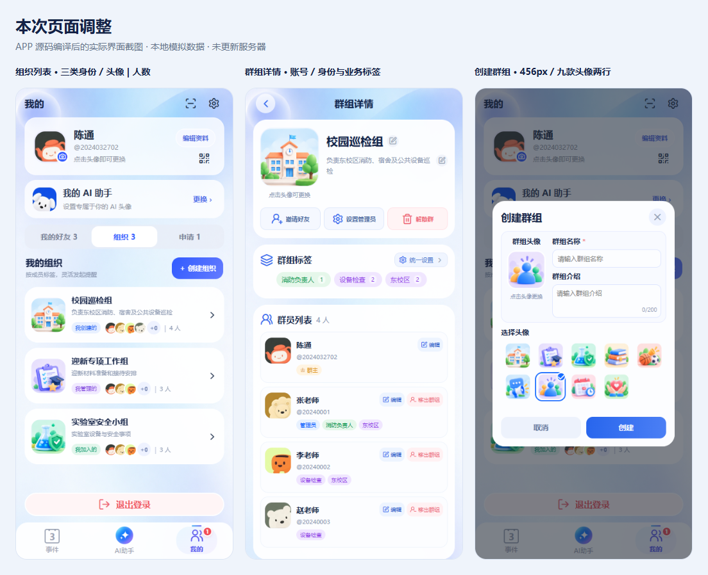
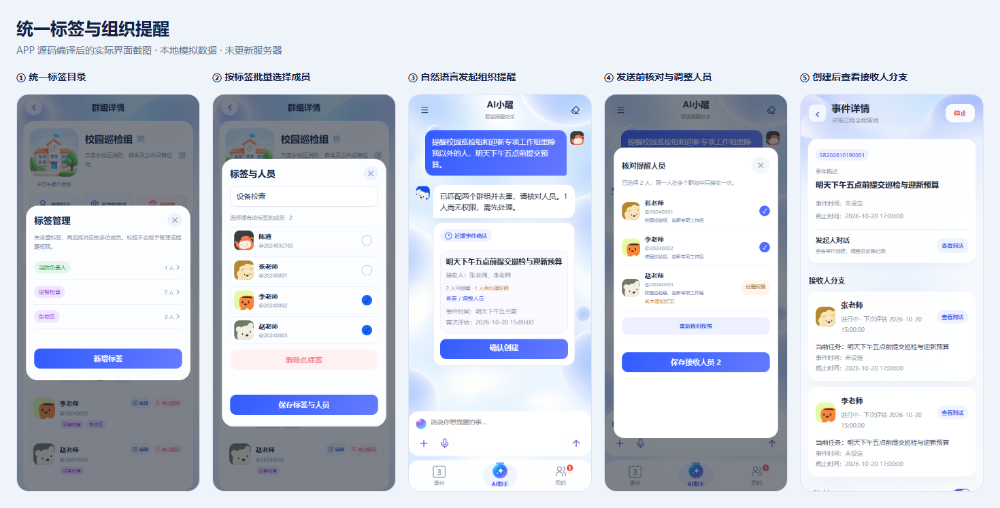
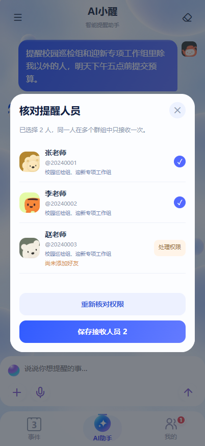

# 群组界面优化与提醒接口说明

日期：2026-10-19。此次修改同步 APP 源码和 Web 页面，未部署服务器。以下截图是 APP 源码经 HBuilderX 编译后的浏览器实拍，采用本地模拟接口数据；不代表真实大模型识别、真实群组数据或手机推送已完成线上验证。

## 一、此次界面调整

- 群组成员姓名下方恢复显示 `@账号`。群主身份固定黄色，管理员身份固定蓝色；业务标签使用紫、绿、粉三类配色。同名业务标签在各入口保持相同颜色。标签不授予管理或提醒权限。
- 创建弹窗高度从 558px 缩至 456px；九款预设头像每行五个、共两行。保留随机默认头像、自定义上传、名称必填、介绍选填，以及创建成功后进入详情页的行为。
- 组织列表恢复“我创建的 / 我管理的 / 我加入的”三类身份标签，分别使用蓝、紫、绿。卡片右侧使用箭头；简介单行省略。头像最多四个，后接 `+剩余人数`，再以 `|` 分隔实际总人数。首个头像不使用负边距。

## 二、统一标签设计

入口：群组详情 → 群组标签 → 统一设置。

1. 标签目录展示当前群组所有标签及对应人数，可新增标签。
2. 点击一个标签，进入“标签与人员”：编辑标签名，批量勾选或取消成员，保存后统一更新该标签的人员归属。
3. 删除标签需要确认；删除不移出成员，也不改变成员角色。
4. 另一条入口是群员行中的“编辑”：查看、移除该人的现有标签，快捷选择已有标签或新建标签。
5. 普通成员可设置自己的标签；群主、管理员可管理群组标签及成员标签。设置管理员由群主操作，业务标签不会改变角色。

## 三、组织提醒与人员查看

用户直接在 AI 对话中输入自然语言，例如：

> 提醒校园巡检组和迎新专项工作组里除我以外的人，明天下午五点前提交预算。

不增加单独的范围选择入口。后台向 AI 提供当前用户可发起提醒的群组目录和标签目录，按需要查找真实成员；跨群组按用户 ID 去重并保留来源群组。匹配有歧义时应先反问。

事件候选卡片展示接收人姓名、可提醒人数和需处理权限人数。点击“查看／调整人员”可查看账号、来源群组、勾选状态，以及“尚未添加好友 / 尚无提醒权限”的原因。无权限人员不能直接勾选，可申请权限后重新核对。

调整人员只保存候选范围；点击“确认创建”才创建事件。最终仍按发起人与每个接收人的好友方向权限校验。群主或管理员身份不能扩大个人好友权限。若保留未解决的权限问题，需要明确确认只发送给当前有权限的人员。

创建后，通过对话里的“查看事件”打开事件详情，在“接收人分支”中查看实际接收人、各自任务和跟进时间，并进入对应对话。候选阶段调整与创建后的分支查看是两个入口。

## 四、接口

以下为客户端 `/api` 代理路径，均为 POST，需当前 APP 用户登录身份；后端 Controller 路径本身不包含代理前缀 `/api`。ID 在客户端按字符串传递，避免 64 位整数精度损失。常规响应使用 `{code, success, data}` 包装。

| 用途 | 接口 | 参数 |
| --- | --- | --- |
| 读取群组及标签、成员 | `/api/app/reminder/groups/detail?groupId=1001` | 查询参数 `groupId` |
| 按标签批量设置人员 | `/api/app/reminder/groups/tags/save` | JSON `{groupId, tagId, name, userIds}`；新增时 `tagId=null` |
| 删除标签 | `/api/app/reminder/groups/tags/delete` | JSON `{groupId, tagId}` |
| 按人员设置多个标签 | `/api/app/reminder/groups/member/tags` | JSON `{groupId, userId, tags:["设备检查","东校区"]}` |
| APP 提交自然语言提醒 | `/api/app/reminder/chat/jobs/submit` | JSON `{requestId, content, fileIds:[], supportsGroupRecipients:true}` |
| 查询对话任务状态 | `/api/app/reminder/chat/jobs/status` | JSON `{requestId}` |
| 订阅对话结果 | `/api/app/reminder/chat/jobs/watch` | JSON `{requestId}`，SSE |
| 查看候选人员 | `/api/app/reminder/candidate/recipients` | JSON `{candidateId, eventIndex:0}` |
| 调整候选人员 | `/api/app/reminder/candidate/recipients/save` | JSON `{candidateId, eventIndex:0, userIds:["201","202"]}` |
| 确认创建 | `/api/app/reminder/candidate/confirm` | JSON `{candidateId, acceptConflicts:false, acceptPartialRecipients:false}` |
| 查看已创建事件的接收人分支 | `/api/app/reminder/event/detail?eventId=6001` | 查询参数 `eventId`；响应 `data.branches` 是实际接收人分支 |

组织提醒沿用对话接口，无需客户端另外传一个固定 `groupId`。`requestId` 每次新请求使用唯一值，重试同一次请求沿用该值。旧版 Web 对话也保留 `/chat/send` 与 `/chat/stream` 入口。

`candidate/recipients` 返回 `data.event.recipientPool` 和 `data.selectedUserIds`。每个人包含姓名、账号、头像、`groupSources`、`canRemind`、`permissionIssue` 等字段。截图示例为三个去重后的成员：两人可提醒，一人尚未成为好友；最后只选择前两人创建事件。

实际源码位置：`ReminderGroupController.java`、`SmartReminderController.java`，以及 APP 的 `GroupList.uvue`、`GroupEditor.uvue`、`pages/group-detail/index.uvue`、`CandidatePeople.uvue`。

## 五、原始截图与验证边界

- [组织列表](assets/groups139/group-final-01-list.png)
- [紧凑创建弹窗](assets/groups139/group-final-02-create.png)
- [群组详情：账号与身份配色](assets/groups139/group-final-03-detail.png)
- [统一标签目录](assets/groups139/group-final-04-tag-catalog.png)
- [按标签批量选择人员](assets/groups139/group-final-05-tag-members.png)
- [对话发起组织提醒](assets/groups139/group-final-06-chat.png)
- [候选卡片查看与调整人员](assets/groups139/group-final-07-recipients.png)
- [已创建事件接收人分支](assets/groups139/group-final-08-event-people.png)
- [320px 边界：六个预览头像限制为四个，七人显示 +3](assets/groups139/group-final-edge-320.png)
- [320px 创建弹窗](assets/groups139/group-final-create-320.png)
- [本地截图总览 HTML](assets/groups139/group-final-gallery.html)

验证：APP 项目结构检查通过；HBuilderX Web 编译通过；Web production 构建通过。浏览器检查了 APP 编译页面和 Web 的 402px、320px 布局、456px 弹窗、九款头像、身份配色及账号；通过实际界面操作验证了模拟环境下标签保存、对话提交、候选人员保存、确认创建及分支查看的请求参数。

未执行线上部署、真实模型调用、真实通知发送或 Android/iOS 签名包构建；手机原生实际效果仍需后续真机验证。

## 六、本轮兼容与人员弹窗修订

核对人员弹窗按人数估算高度，三人时为 506px，较多人员限制高度并滚动；两颗操作按钮统一放在底部，宽度一致、高度均为 44px。402px 浏览器实测按钮 326×44px，下方边距 18px。320×620 窄屏、20 人名单的底部按钮保持可见。

新增可选请求字段 `supportsGroupRecipients`，默认 false；省略或传 null 均按旧客户端处理。新版 APP 的异步提交以及 Web 的同步、流式、异步提交都显式传 true，后台异步任务复制请求时保留该字段。

旧版 APP 不获取群组目录和群组输出协议，个人与好友提醒继续沿用旧流程。如果模型仍输出群组查询或群组选人条件，服务端在查询成员或执行创建前转为普通文字升级提示，不产生旧客户端无法操作的新群组候选卡。跨版本查看既有群组候选时，后台的权限复核、冲突确认、部分人员发送确认仍然有效，不会因客户端旧而绕过。

旧客户端消息的幂等哈希仍使用原来的内容与附件算法；新能力参与新版请求的哈希，避免同一请求编号被用于不同能力语义。新增的确认参数仍可省略，默认不接受冲突、不接受部分人员发送。

数据库迁移只新增四张群组关系表（`CREATE TABLE IF NOT EXISTS`），不删除旧表或既有提醒数据。服务端应先完成数据库迁移再接入新版群组页面；发布过程仍存在常规服务重启窗口。此次未部署，未使用旧版手机安装包连接真实升级环境进行验证。

兼容验证：群组隔离数据库回归 56 项断言通过；旧对话上下文及原有事件操作回归通过；后台任务幂等、重启、取消、回滚、能力透传及旧哈希兼容回归通过。APP 与 Web 编译通过。本次截图仍为本地模拟数据。

